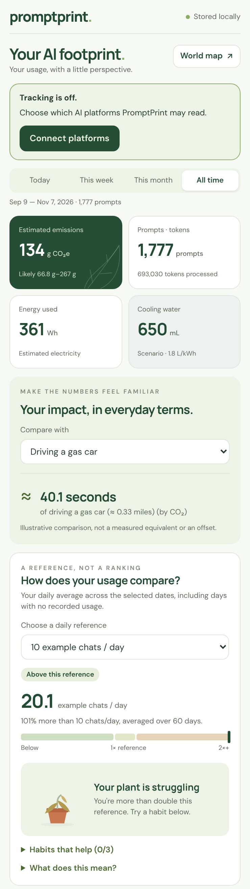
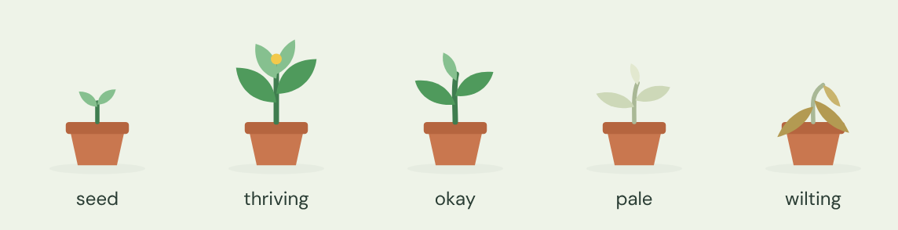

# Evergreen: AI Carbon Footprint Tracker

A Chrome extension that tracks how you use AI chatbots (ChatGPT, Claude, Gemini), estimates the carbon footprint of your prompts, and suggests lower-impact alternatives for the tasks you rely on AI for most.

Built for the Binghamton hackathon **Environment track**. See [PLAN.md](PLAN.md) for the full project plan.

## Features
- **Asks first:** on install a welcome page lists every supported AI platform; nothing is tracked until you allow a site in Chrome's permission prompt. **Your connected platforms** in the popup switches each AI on or off anytime (off removes the extension's access to that site).
- **Usage tracking:** counts the prompts you send on the platforms you've connected.
- **Load data:** re-reads your open AI tabs (connected platforms only) and adds any prompts that weren't counted yet. Never double-counts.
- **Import past history:** reads the chat exports from ChatGPT, Claude and Google Takeout (Gemini) to show your footprint from before you installed it.
- **Screen Time–style history:** Day / Week / Month / All time, with ‹ › to step back through past days, weeks and months. A bar chart colored by AI shows CO₂ per hour (day), per day (week and month, with a dashed daily average) or per month; tap a bar to open that day. Your top AIs for the period are listed underneath.
- **Totals:** estimated emissions (with a likely range), prompts and tokens, electricity, and a cooling-water scenario for the selected period.
- **Everyday comparisons:** driving, LED bulb, phone charges, streaming, water bottles, trees and more.
- **How does your usage compare?** Your prompts per day against the average ChatGPT user (about 3.7 a day, from OpenAI's research), with **a plant** that thrives well below average, goes pale above it and wilts past double. **What does this mean for the environment?** turns your use into yearly CO₂, climate-damage cost, cooling water and electricity. **Habits that help** is a checklist under it.
- **Which AI you use:** the split by prompts, CO₂ or electricity, with each AI's exact numbers, average energy per prompt, and whether that figure is **published** or **our estimate**.
- **Suggestions:** lower-impact alternatives for the tasks you use AI for most (prompts are sorted into Math, Coding, Writing, Research, Brainstorm or Other behind the scenes).
- **World map:** what your usage would emit on each country's power grid.
- **Image generation:** detects generated images in AI replies (large images, not icons), including ones that appear after the text, on Load data, and in imported ChatGPT history. Each adds about 2.9 Wh; the popup shows image counts and a tip when images take a big share of your energy. Sites without a mapped layout (Perplexity, Copilot, DeepSeek, Grok, Mistral) can't detect images yet.
- **AI icons:** each platform shows its real site icon from Chrome's own icon cache (the `favicon` permission, no network request). Sites you haven't visited yet show a colored letter badge until you do.
- **Collapsible platforms list:** click **Your connected platforms** to collapse it to a row of the connected AIs' icons; Evergreen remembers your choice.
- **Private:** everything stays in your browser unless you opt in to map sharing. Prompt text is never saved; only the category and lengths are.
- **Help build the world map (opt-in):** shares anonymous daily totals per AI (prompts, energy, CO₂, task categories, your country, a random ID) with a Supabase database. Off by default; switch off and delete everything you shared from the popup. The world map then shows each country's Evergreen users, prompts, CO₂ and favorite AIs (countries with fewer than 3 sharing users stay hidden). Setup: see **Setting up the shared database** below.





## Supported AI sites
| Site | Live tracking | Reply length measured | Load data | History import |
|---|---|---|---|---|
| ChatGPT (chatgpt.com) | ✅ | ✅ | ✅ | ✅ |
| Claude (claude.ai) | ✅ | ✅ | ✅ | ✅ |
| Gemini (gemini.google.com) | ✅ | ✅ | ✅ | ✅ |
| Perplexity, Copilot, DeepSeek, Grok, Mistral Le Chat | ✅ (counted when you press send) | ❌ typical length assumed | ❌ | ❌ |

**Not trackable live:** the phone and desktop apps, and any browser without the extension. Their chats *are* included in each AI's data export, so **Import past chat history** covers them for ChatGPT, Claude and Gemini.

Energy per prompt is published only for Gemini and ChatGPT; every other AI uses an assumed 0.3 Wh (see `lib/constants.js`).

## Install (developer mode)
1. Download this repository: **Code → Download ZIP** on GitHub, then unzip it. Or clone it with Git.
2. In Chrome, go to `chrome://extensions`.
3. Turn on **Developer mode** (top right).
4. Click **Load unpacked** and choose the project folder (the one containing `manifest.json`).
5. Pin the extension: click the puzzle-piece icon, then the pin next to **Evergreen**.
6. A welcome page opens: tick the AI platforms you use and click **Allow tracking on selected platforms**, then confirm Chrome's prompt.
7. Use any connected AI site as usual. Click the icon and press **⟳ Load data** to also pick up chats already open in your tabs, or **Import past chat history** for older chats.

After changing code, click the reload button on the extension's card in `chrome://extensions`, then refresh any open AI tabs.

## Project structure
| File | What it does |
|---|---|
| `manifest.json` | Chrome's configuration: AI sites are *optional* permissions, granted per site by the user |
| `welcome.html` / `welcome.css` / `welcome.js` | First-run page that explains what's tracked and asks permission per AI platform |
| `lib/icons.js` | AI platform icons from Chrome's favicon cache, with letter-badge fallback |
| `lib/config.js` | Supabase project URL and public key for map sharing (empty = sharing off) |
| `supabase/setup.sql` | Database table and functions for anonymous shared totals |
| `lib/ui.css` | Shared design tokens and components (colors, fonts, panels, buttons, switches) |
| `content.js` | Runs on the AI sites. Spots each prompt you send and measures the reply length |
| `background.js` | Registers the tracker only for allowed sites, categorizes prompts, estimates energy and carbon, saves events without duplicates, runs **Load data** |
| `popup.html` / `popup.css` / `popup.js` | The 370px popup: totals, everyday comparison, usage comparison with the plant, AI breakdown, tasks, suggestions, connected platforms, Load / Import / Clear |
| `import.html` / `import.css` / `import.js` | The history importer: reads ChatGPT / Claude / Gemini export files in the browser (nothing is uploaded) |
| `map.html` / `map.css` / `map.js` | The interactive world map: your real usage and what it would emit on each country's power grid |
| `lib/grid-data.js` | Carbon intensity of each country's electricity grid (approximate, Ember / Our World in Data 2023) |
| `lib/constants.js` | Shared assumptions: energy per prompt, colors, everyday comparisons, number formatting |
| `lib/d3.min.js`, `lib/topojson-client.min.js` | Map-drawing libraries (D3 v7.9.0, topojson-client v3.1.0, ISC license) |
| `data/countries-110m.json` | Country shapes (world-atlas v2.0.2, ISC license; Natural Earth, public domain) |
| `assets/` | Icons |

## Setting up the shared database
Sharing is built in but needs a database before it can be switched on:

1. Create a free project at **supabase.com**.
2. In the project, open **SQL Editor → New query**, paste all of `supabase/setup.sql`, and click **Run**. This creates one table and three functions (`submit_usage`, `delete_my_data`, `community_stats`). The public key can only call those functions; it can't read or change the table directly.
3. In **Project Settings → API**, copy the **Project URL** and the **anon public** key into `lib/config.js`. Never put the `service_role` key in the extension.
4. Reload the extension. "Help build the world map" in the popup and the welcome page now work, and the map's **Color the map by** menu unlocks the community measures.

**How it works:** once someone opts in, Evergreen re-sends their last 30 days as daily totals per AI every 6 hours (and right away when switched on). Each install has a random ID so it can update and delete its own rows. The map asks for per-country totals over the last 30 days; countries with fewer than 3 sharing users are left out (`minUsersPerCountry` in `lib/config.js`).

**Before publishing on the Chrome Web Store:** add a privacy policy and declare the shared data in the listing. For a public launch, also add rate limiting (anyone with the public key could submit made-up totals; values are capped, which is fine for a hackathon).

## Past history (before installing)
Live tracking only sees prompts sent after installing. For older chats, use **Import my real chat history** in the popup. It reads the export ZIPs from ChatGPT (Settings → Data controls → Export data), Claude (Settings → Privacy → Export data) and Google Takeout (My Activity → Gemini Apps, JSON format). Only chats from before the install date are imported, and re-importing never double-counts.

These export formats aren't officially documented. The Gemini importer has been confirmed with a real Google Takeout export; the ChatGPT and Claude parsers follow the commonly seen structure and were tested with sample files. If an import finds 0 prompts, compare the real file to the parser in `import.js` and adjust it.

## Methodology
No AI company publishes exact per-prompt figures for every model, so these are **transparent estimates**:

```
tokens    ≈ characters ÷ 4
energy_Wh = base Wh per prompt × (reply tokens ÷ 500), clamped to 0.25×–10×
g CO₂e    = energy_Wh ÷ 1000 × grid intensity (g CO₂e per kWh)
```

| Assumption | Value | Source |
|---|---|---|
| Gemini, per median text prompt | 0.24 Wh | Google, *Measuring the environmental impact of AI inference* (Aug 2025) |
| ChatGPT, per average query | 0.34 Wh | Sam Altman, *The Gentle Singularity* (June 2025) |
| Claude, per prompt | 0.30 Wh | No official figure; our assumption |
| Grid carbon intensity | 400 g CO₂e/kWh | Approximate US average (EPA eGRID) |
| Displayed range | 0.5× to 2× the estimate | Reflects uncertainty in all of the above |
| Phone charge / mile driven | 12.4 g / 400 g CO₂ | EPA Greenhouse Gas Equivalencies Calculator |
| Generated image | ≈ 2.9 Wh per image, added to the prompt's text estimate | Luccioni, Jernite & Strubell, *Power Hungry Processing: Watts Driving the Cost of AI Deployment?* (2023): image generation averaged ~2.9 kWh per 1,000 images. Varies a lot by model and image size |
| Average AI use | ≈ 3.7 prompts/day per user | OpenAI / NBER, Chatterji et al., *How People Use ChatGPT* (working paper w34255, Sept 2025): ~18 billion messages a week from ~700 million weekly users (July 2025) |
| Climate damage | ≈ $190 per tonne CO₂ | US EPA, social cost of carbon (2023 update, 2% discount rate) |

All values can be changed at the top of `background.js` and `popup.js`. Verify each source before presenting.

## Troubleshooting
- **Nothing is tracked:** check **Your connected platforms** in the popup; the site's switch must be on.
- **Prompts aren't being counted:** the AI sites change their HTML often. Open the site, press F12, inspect one of your messages, and update `SELECTORS` at the top of `content.js`. The Console shows `[Evergreen] tracking <site>` when the script is running.
- **"Extension context invalidated" in the console:** you reloaded the extension; refresh the AI tab.

## Team
_Add your names here._

## License
MIT. See [LICENSE](LICENSE).
